# Floorplan 3D Studio

**Turn a 2D floor plan into a furnished 3D floor plan in the browser** — draw or trace the walls, drop in doors, windows
and furniture, pick a style preset, then export high-res renders, a GLB model and a walkthrough video.
React + TypeScript + three.js (react-three-fiber). Runs locally, no GPU and no cloud services needed.

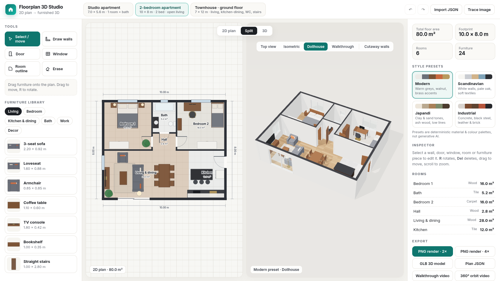

| 2D plan (input) | Furnished 3D (output) |
| --- | --- |
| 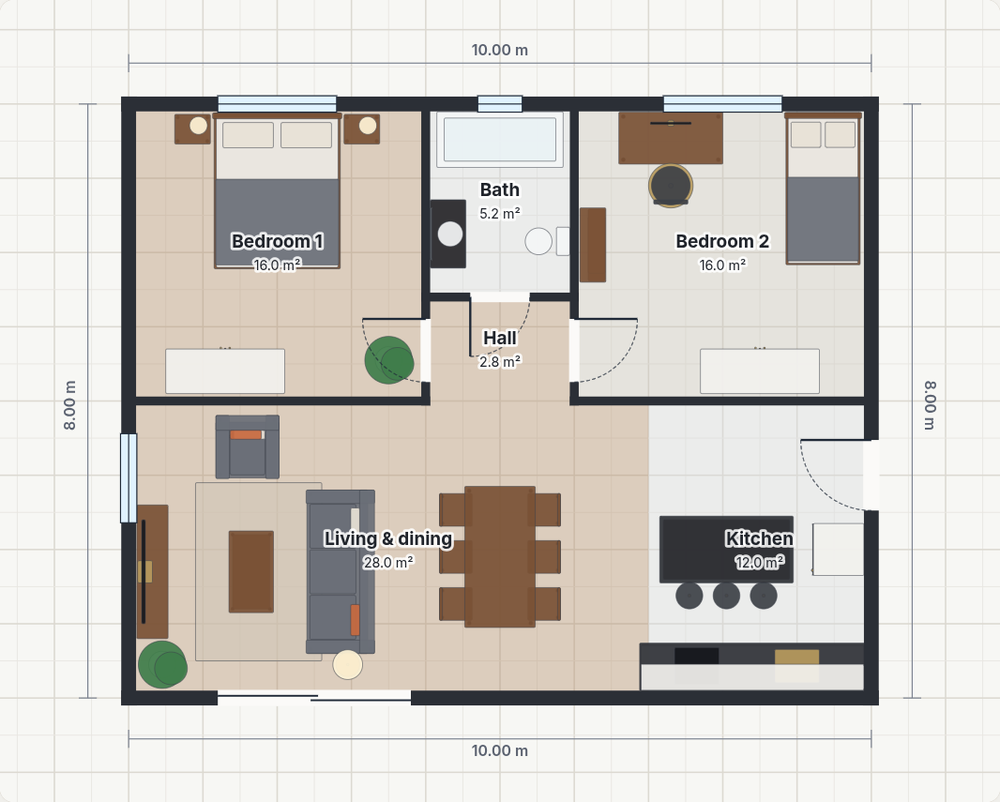 | 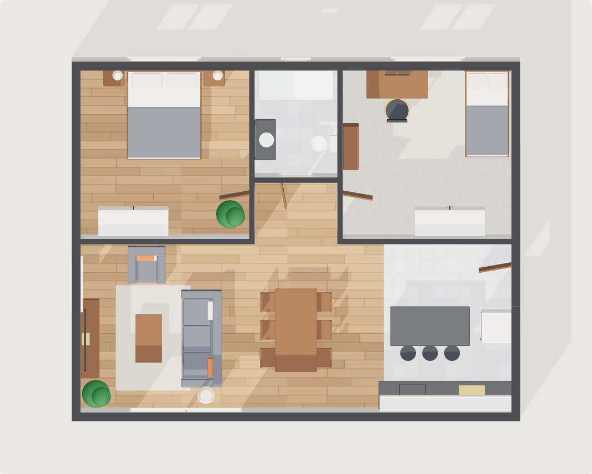 |

## Render modes

| Dollhouse (perspective) | Isometric cut-away | Top view | First-person walkthrough |
| --- | --- | --- | --- |
| 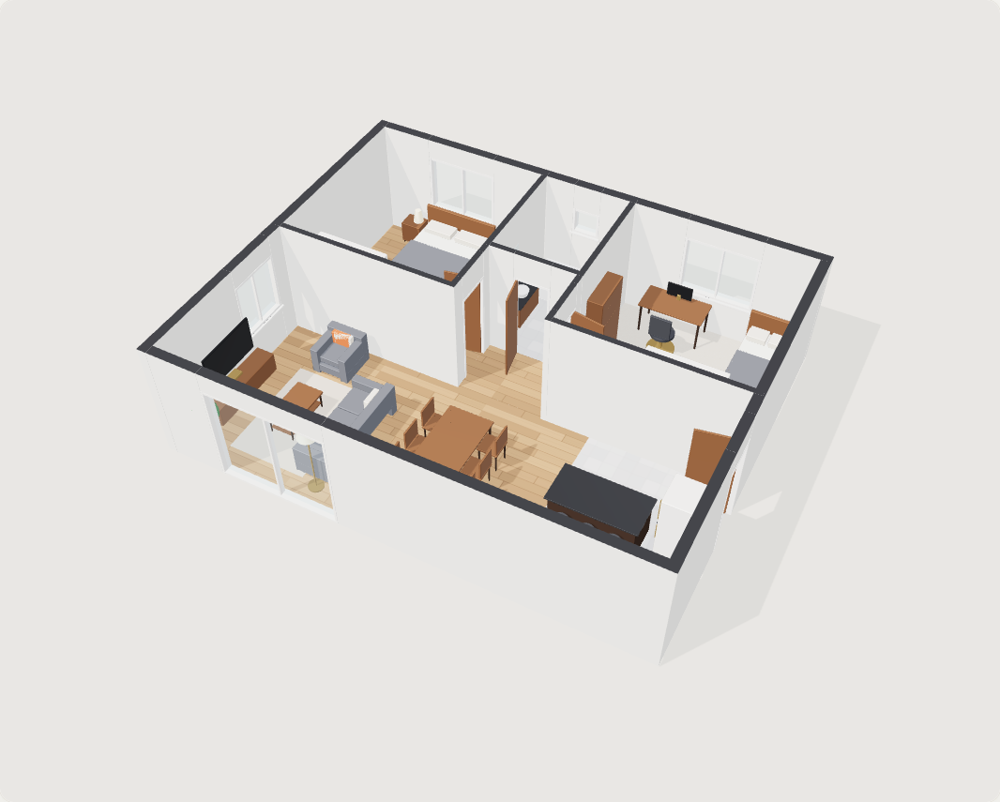 | 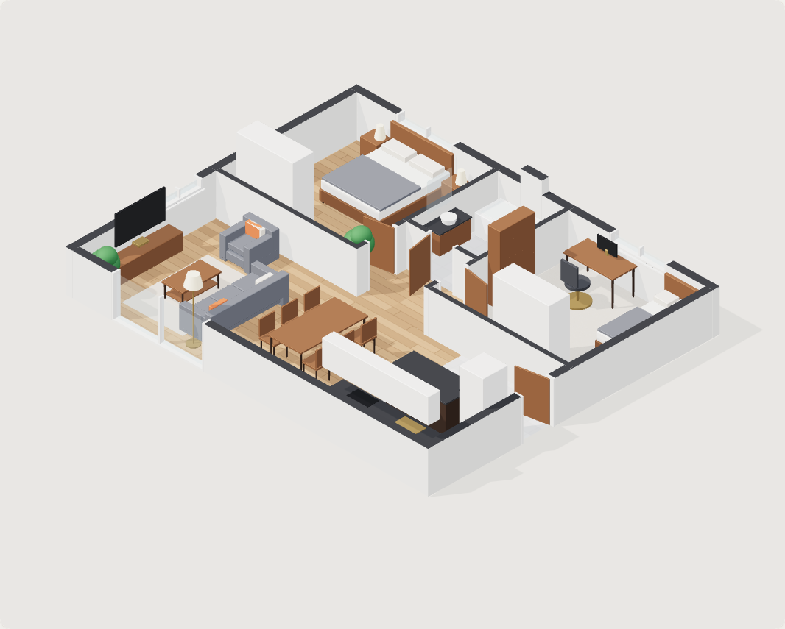 | 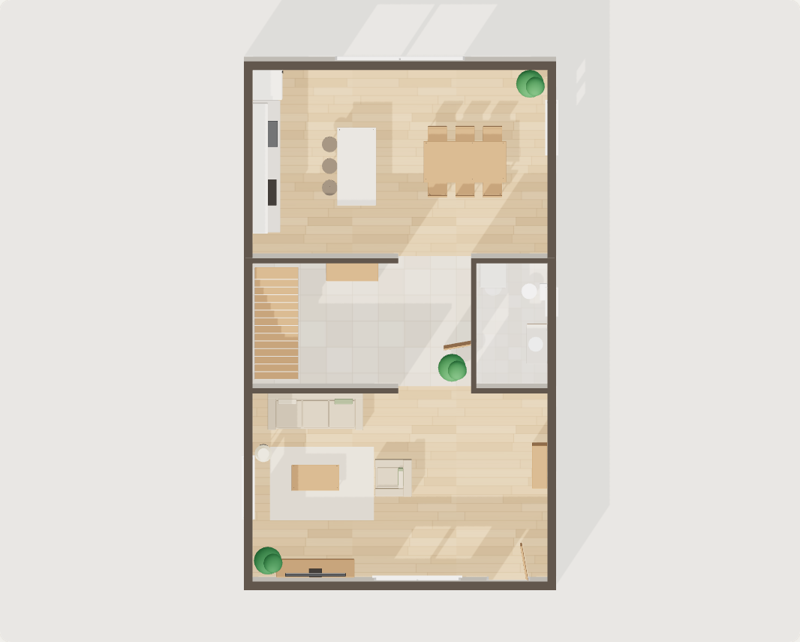 | 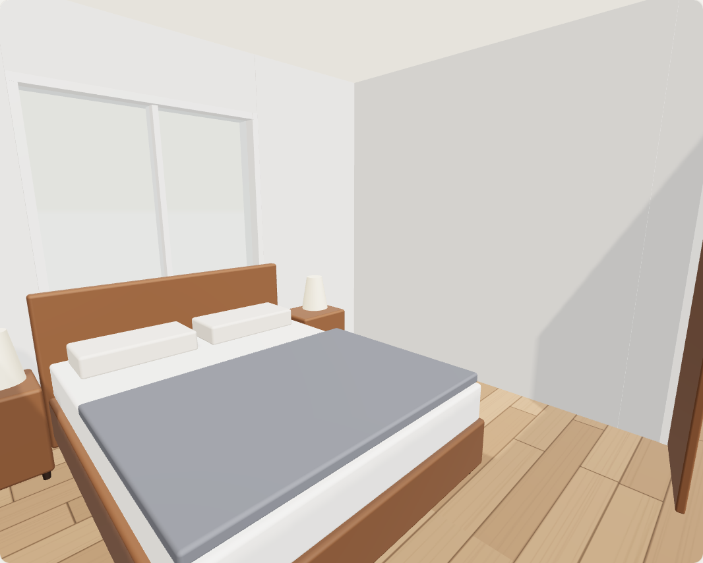 |

**Walkthrough & 360° videos** (rendered frame-by-frame from the app): [2-bed walkthrough](docs/walkthrough-twobed.mp4) ·
[townhouse walkthrough](docs/walkthrough-townhouse.mp4) · [2-bed 360° orbit](docs/orbit-twobed.mp4) · [townhouse 360° orbit](docs/orbit-townhouse.mp4)

## Style presets (deterministic, not generative AI)

One click swaps wall paint, floor finishes and the whole furniture palette. These are hand-tuned material palettes —
the geometry and layout stay exactly as drawn, which is what a client wants when comparing finishes.

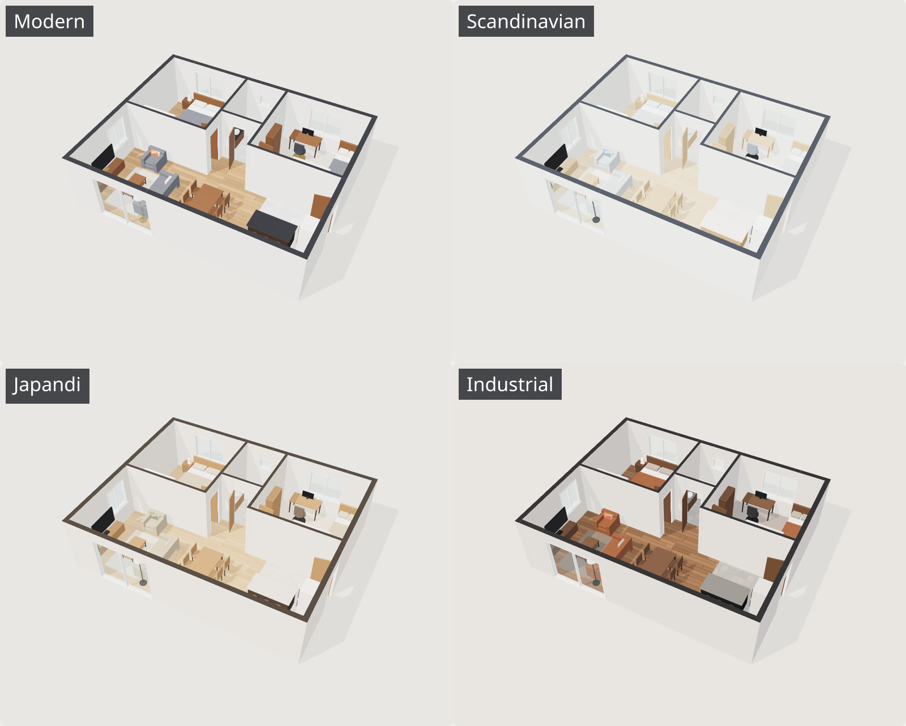

## Three demo plans

Sample layouts drawn for this portfolio project (not client work):

| Studio apartment · 39 m² | 2-bedroom apartment · 80 m² | Townhouse ground floor · 84 m² |
| --- | --- | --- |
| 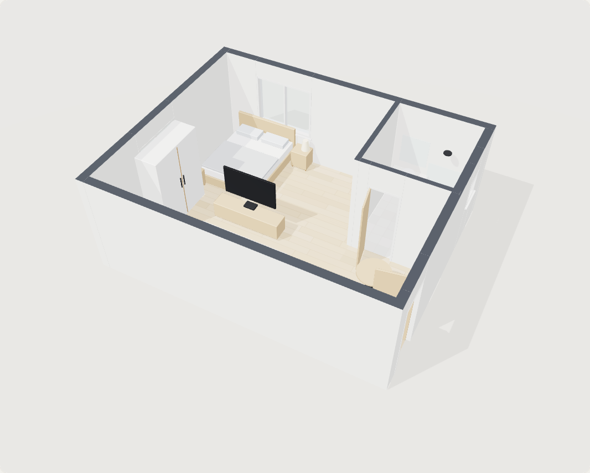 |  | 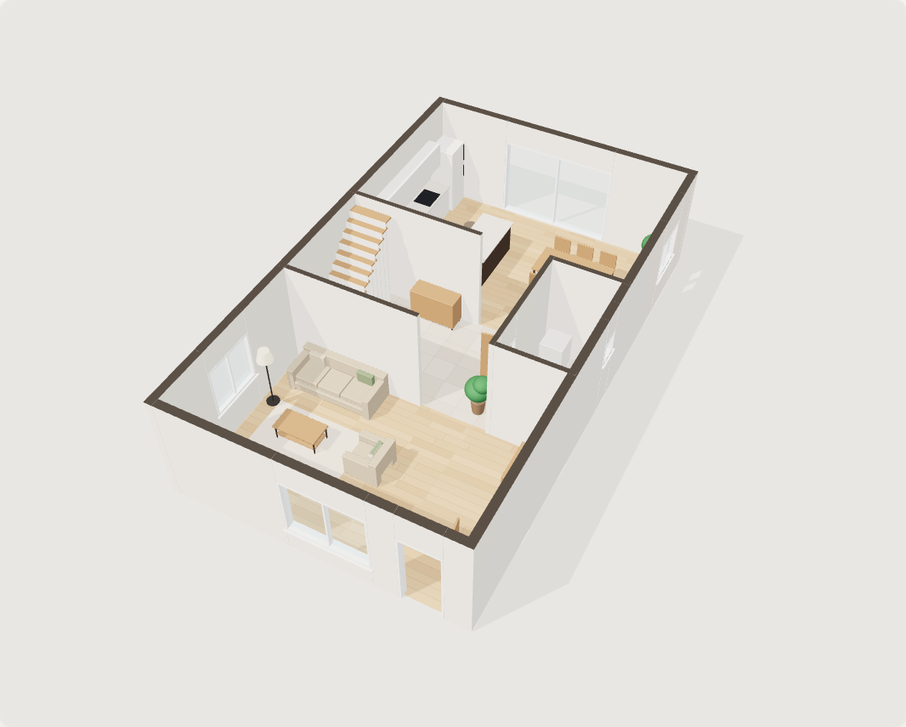 |
| 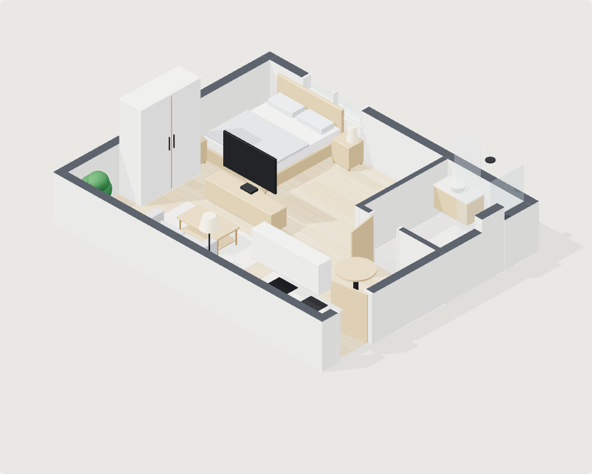 |  | 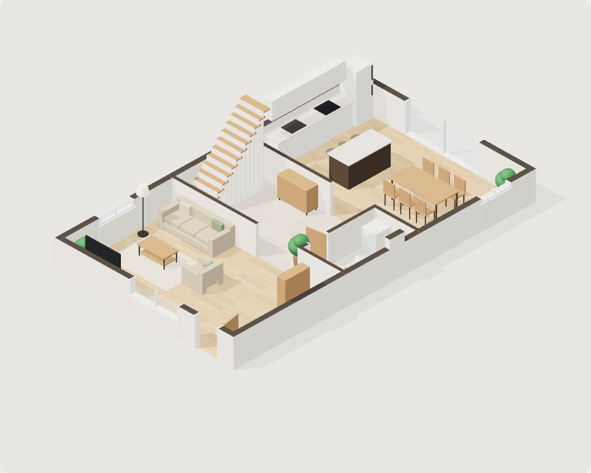 |

## Features

**2D editor**
- Walls: click-to-draw chains, snapping to a 10 cm grid and to existing wall ends, drag wall end handles, thickness / height per wall
- Doors (with swing arc and flip), windows (sill / head height) and sliding doors: click a wall to place, drag along the wall
- Rooms: polygon outline tool, name, floor finish (wood, tile, carpet, concrete, stone), live area in m²
- Automatic dimension lines on exterior walls, room labels with area, total floor area and footprint
- Furniture library (30 pieces in 6 categories: living, bedroom, kitchen & dining, bath, work, decor) — drag onto the plan, move, rotate (R), duplicate, delete; plan symbols are generated from the same parts as the 3D model
- Import / export the plan as JSON; upload an image (photo or scan of a plan) as a tracing background with opacity & scale
- Undo / redo (Ctrl+Z / Ctrl+Shift+Z), pan & zoom

**3D**
- Walls generated with real openings (spans above / below windows, door and window frames, glass, open door leaves)
- Procedural floor textures, studio lighting with soft shadows and environment reflections
- Render modes: **top view** (orthographic), **isometric** (orthographic cut-away), **dollhouse** (perspective orbit), **walkthrough** (drag to look, WASD to walk) and an optional **cut-away walls** toggle
- 4 style presets: Modern, Scandinavian, Japandi, Industrial

**Exports**
- PNG renders at 2× or 4× the viewport (e.g. 4264 × 3420 px), any render mode
- **GLB** of the whole furnished plan (walls, floors, furniture, materials) — opens in Blender, three.js, model-viewer, Unity / Unreal importers
- Walkthrough video and 360° orbit video (WebM, recorded from the canvas in the browser); frame-exact MP4 via `tools/shots.py`
- Plan JSON

## What a client receives

| Package idea | Deliverables produced by this tool |
| --- | --- |
| Basic | 1 top-view + 1 perspective (dollhouse) PNG render, 1 style |
| Standard | Top + isometric + dollhouse renders, 2 style presets, GLB model, 2D plan with dimensions |
| Premium | Everything above + room-by-room walkthrough video + 360° orbit video + all 4 style presets + plan JSON for edits |

## Run locally

```bash
npm install
npm run dev        # http://127.0.0.1:5180
npm test           # geometry + demo-plan integrity tests (vitest)
npm run build      # type-check + production build in dist/

# media (headless Chrome, SwiftShader WebGL; needs `pip install playwright` and Chrome)
python3 tools/shots.py               # screenshots, style collage, 2D vs 3D, exports, walkthrough & orbit MP4s
```

## Project structure

```
src/types.ts              plan data model (walls, openings, rooms, items, style)
src/geometry.ts           areas, centroids, wall/opening spans, snapping, JSON validation
src/data/furniture.ts     procedural furniture library (parts -> 3D meshes and 2D plan symbols)
src/data/styles.ts        style presets (wall paint, floor finishes, material palette, light colour)
src/data/demoPlans.ts     3 demo plans
src/components/Editor2D   SVG plan editor (tools, snapping, drag & drop, dimensions)
src/components/Scene3D    react-three-fiber scene, cameras for every render mode, walkthrough controls
src/three/build.ts        plan -> three.js group (shared by the viewer and the GLB exporter)
src/three/exporters.ts    PNG (hi-res), GLB, JSON, WebM recording
src/three/tour.ts         deterministic room-by-room walkthrough camera path
tools/shots.py            README media + export checks
```

## Limitations (honest scope)

- Single storey per plan; stairs are a furniture block, not a connected second floor
- Image upload is a **tracing background** — walls are drawn by hand on top of it; there is no automatic plan recognition
- Furniture is procedural and stylised (boxes, cylinders, rounded edges), not photoreal catalogue models; photoreal renders on paid work are done in Blender with real assets
- Style presets swap materials and colours deterministically; they don't move furniture or invent a new layout
- Walls are straight segments (no curved walls); room floors are polygons you draw (not auto-detected from walls)
- Browser video export is WebM (MediaRecorder); MP4 comes from the frame-by-frame script

## Credits & license

[three.js](https://threejs.org) (MIT) · [react-three-fiber](https://github.com/pmndrs/react-three-fiber) and [drei](https://github.com/pmndrs/drei) (MIT) ·
[zustand](https://github.com/pmndrs/zustand) (MIT) · [Vite](https://vitejs.dev) (MIT). This repository's code is MIT © Tran Cong Tien.

---

**Need your floor plan as a furnished 3D plan, renders or a walkthrough video?** Hire me on Fiverr: [fiverr.com/optimus2003](https://www.fiverr.com/optimus2003)
