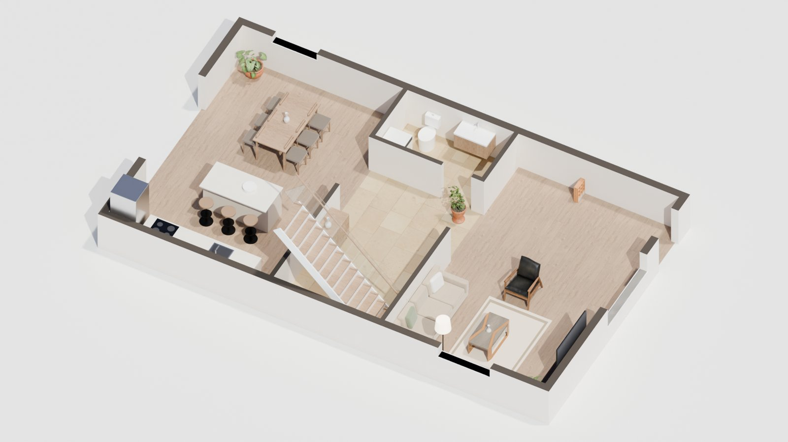
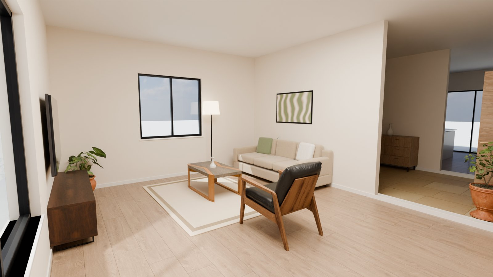
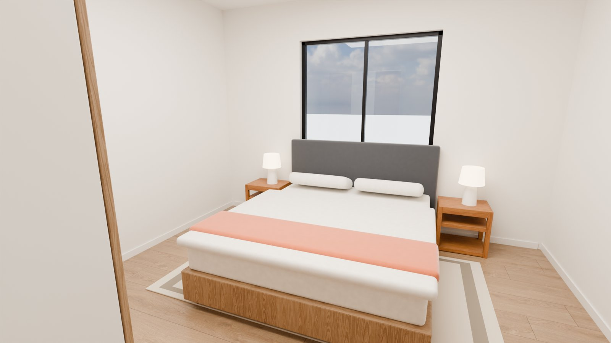

# Blender render worker (photoreal output for Floorplan 3D Studio)

The web app is for drawing and previewing. This worker turns the app's **Plan JSON** export into
client-grade Cycles renders: real wall openings, PBR floors, baseboards, CC0 furniture sized to the plan,
sun + HDRI daylight.

```
plan JSON  ──►  render_plan.py (Blender 4.2, headless)  ──►  top / dollhouse / isometric / interior PNGs
```

| View | What it is |
|---|---|
| `top` | orthographic furnished 2D->3D plan (dark wall cuts, soft sun) |
| `dollhouse` | isometric cutaway, walls cut at 1.2 m (`--cut`) |
| `iso` | isometric, full-height walls |
| `interior1`, `interior2` | eye-level shots defined in `shots.json` (camera, lens, fill lights, exposure) |
| `<view>_hero` | the same view at 2560x1440 |

## Run

```bash
python3 blender/fetch_assets.py                    # CC0 assets from Poly Haven -> blender/assets/
npx vite-node blender/export_plans.ts               # demo plans -> blender/plans/*.json (or use the app's "Plan JSON" button)
blender -b -P blender/render_plan.py -- --plan blender/plans/twobed.json --out blender/renders/twobed \
        --views top,dollhouse,iso,interior1,interior2 --samples 48 --samples-interior 96
```

Options: `--pct 40` (preview size), `--cut 1.2` (dollhouse wall height), `--save-blend` (keep the scene).
Every run also writes `<plan>_report.json` with wall lengths, room sizes, built outer size and render times,
so the 3D can be checked against the 2D dimension labels.

Measured on an 8-vCPU cloud box, CPU only (no GPU), Cycles + OpenImageDenoise, 1920x1080:
top ~1.5-2 min, dollhouse ~1 min, interiors ~4-8 min, 2560x1440 hero ~10 min (see the report files).

## Dimensions

Plan coordinates are metres on wall centre-lines, the same numbers the 2D editor labels
(`7.00 m`, `5.60 m` ...). Walls are built centred on those lines with their real thickness, so the outside
of a 7.0 x 5.6 m plan with 0.2 m walls measures 7.2 x 5.8 m.

## Blender MCP

`render_plan.py` is plain `bpy` and runs headless, which is what a server needs. For interactive work an
AI client can drive the same functions inside a Blender GUI through
[MCP for Blender](https://github.com/ahujasid/mcp-for-blender) (`uvx mcp-for-blender setup`, then enable the
addon); it is optional and not needed for these renders.

Asset licences: see [CREDITS.md](CREDITS.md).

## Sample output (demo plans, Cycles CPU)

| | |
|---|---|
|  |  |
|  |  |
|  |  |
